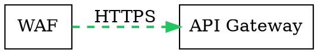

# AGENTS.md — Архитектура локальной системы проектирования архитектурных диаграмм

## 1. Назначение системы

Система предназначена для локального создания, редактирования, проверки и экспорта профессионально оформленных архитектурных диаграмм IT-инфраструктуры, сетевых топологий, информационной безопасности и прикладных информационных систем на macOS.

Система объединяет:

- Графический редактор объектов, контейнеров и связей.
- Движок Graphviz для компоновки и маршрутизации связей.
- Ollama для интеллектуального создания, изменения и проверки диаграмм.
- Python для управления бизнес-логикой и обработки данных.
- SVG-движок для формирования профессионального визуального представления.
- Встроенное версионирование состояния проекта.
- Импорт JSON и экспорт PNG/SVG.

**Основной принцип:** пользователь может создавать и изменять диаграмму как через графический интерфейс, так и через текстовый код или инструкции локальной языковой модели.

Все способы взаимодействия должны использовать общую модель данных и обеспечивать согласованность результатов.

Система должна работать локально, без обязательного подключения к внешним облачным сервисам.

---

## 2. Архитектурные принципы

### 2.1. Разделение ответственности

Логика системы разделяется на самостоятельные компоненты:

| Компонент | Ответственность |
|---|---|
| Graphical Editor | Графическое создание и редактирование диаграмм |
| Code Editor | Редактирование исходного описания диаграммы |
| Ollama Integration | Генерация, изменение и проверка диаграмм |
| Canonical Model | Хранение структуры, объектов, свойств и связей |
| Graphviz Engine | Компоновка, маршрутизация и геометрия |
| SVG Renderer | Визуальное оформление диаграмм |
| Version Manager | Хранение и восстановление версий |
| Import/Export Engine | Импорт JSON, экспорт SVG и PNG |
| Validation Engine | Проверка структуры, синтаксиса и геометрии |

### 2.2. Единый источник истины

Каноническое представление диаграммы — структурированная JSON-модель.

Она содержит:

- Объекты и их свойства.
- Контейнеры и вложенные контейнеры.
- Связи и направления.
- Типы и стили соединений.
- Семантические характеристики компонентов.
- Настройки компоновки.
- Параметры визуального оформления.
- Пользовательские ограничения размещения.

DOT является редактируемым представлением Graphviz, формируемым из канонической модели.

SVG и PNG рассматриваются как результирующие представления.

Изменения, внесённые через интерфейс, код или Ollama, должны проходить через единый механизм обновления состояния.

### 2.3. Детерминированность

Повторная отрисовка одинаковой JSON-модели с одинаковыми параметрами должна давать воспроизводимый результат.

Для этого фиксируются версии Graphviz, рендерера, визуальной темы, алгоритма компоновки и его параметров.

### 2.4. Локальность

Все пользовательские данные, диаграммы, версии, промпты и промежуточные результаты хранятся локально.

Ollama подключается через настраиваемый API endpoint. По умолчанию используется локальный сервер.

---

## 3. Общая архитектура системы

```text
┌────────────────────────────────────────────────┐
│             ГРАФИЧЕСКИЙ ИНТЕРФЕЙС              │
│                                                │
│  Canvas / Toolbar / Properties / Code / AI     │
└──────────────────────┬─────────────────────────┘
                       │
                       ▼
┌────────────────────────────────────────────────┐
│            APPLICATION CONTROLLER              │
│                                                │
│  Commands / State / Events / Undo / Redo       │
└──────────────────────┬─────────────────────────┘
                       │
                       ▼
┌────────────────────────────────────────────────┐
│                CANONICAL MODEL                 │
│                                                │
│  Nodes / Containers / Edges / Styles / Layout  │
└─────────────┬───────────────┬──────────────────┘
              │               │
       ┌──────▼──────┐ ┌─────▼──────────────┐
       │ OLLAMA      │ │ VALIDATION ENGINE  │
       │ INTEGRATION │ │                    │
       │             │ │ Schema / DOT /     │
       │ Generate    │ │ Geometry / Safety  │
       │ Edit        │ └─────┬──────────────┘
       │ Review      │       │
       └──────┬──────┘       │
              │              │
              └──────┬───────┘
                     ▼
┌────────────────────────────────────────────────┐
│           GRAPHVIZ LAYOUT ENGINE               │
│                                                │
│      DOT / dot / neato / Geometry / Routing    │
└──────────────────────┬─────────────────────────┘
                       ▼
┌────────────────────────────────────────────────┐
│          SVG RENDERER + THEME ENGINE           │
└──────────────────────┬─────────────────────────┘
                       ▼
┌────────────────────────────────────────────────┐
│             INTERACTIVE DIAGRAM                │
│                                                │
│            SVG / PNG / Preview                 │
└────────────────────────────────────────────────┘

     VERSION MANAGER ↔ APPLICATION CONTROLLER
     IMPORT / EXPORT ↔ CANONICAL MODEL
```

Version Manager является независимым компонентом хранения снимков состояния.

Все изменения проходят через Application Controller, чтобы исключить несогласованность редакторов и представлений.

---

## 4. Графический интерфейс

### 4.1. Общие требования

Система должна иметь полноценный графический интерфейс, доступный через локальный веб-сервер.

Рекомендуемая архитектура:

- Frontend: React + TypeScript.
- Backend: Python + FastAPI.
- Визуальное представление: SVG.
- Обмен данными: REST API и WebSocket.
- Хранение проектов: JSON и SQLite.

Графический интерфейс должен обеспечивать создание и редактирование диаграмм без обязательного использования текстового кода.

### 4.2. Структура интерфейса

Интерфейс включает следующие логические области.

**Рабочее полотно (Canvas)**

- Отображение диаграммы.
- Масштабирование и панорамирование.
- Выделение одного или нескольких элементов.
- Перемещение объектов.
- Выделение контейнеров.
- Создание соединений.
- Контекстное меню объектов.
- Отображение сетки и направляющих.
- Автоматическое или ручное изменение компоновки.

**Панель инструментов**

- Добавление объекта.
- Добавление контейнера.
- Добавление связи.
- Удаление выбранного элемента.
- Изменение направления связи.
- Запуск автоматической компоновки.
- Сохранение версии.
- Отмена и повтор действия.
- Экспорт и импорт.
- Настройки визуальной темы.

**Панель свойств**

Показывает параметры выбранного элемента и позволяет изменять их без обращения к коду.

**Редактор кода**

Отображает редактируемое DOT-представление диаграммы и предоставляет функции проверки и применения изменений.

**Панель Ollama**

Предоставляет чат, системный промпт, настройки модели, генерацию изменений и режим проверки.

**История версий**

Отображает сохранённые снимки состояния, различия между версиями и действия восстановления.

### 4.3. Объекты

Графический редактор должен поддерживать:

- Создание объектов.
- Изменение названия и описания.
- Выбор семантического типа.
- Изменение формы и размеров.
- Выбор иконки.
- Изменение цвета и границы.
- Ручное размещение.
- Перемещение между контейнерами.
- Копирование и удаление.
- Групповое выделение.

Каждый объект имеет уникальный идентификатор, не зависящий от его отображаемого названия.

### 4.4. Контейнеры

Контейнеры предназначены для логической и визуальной группировки объектов.

Примеры:

- DMZ.
- LAN.
- Kubernetes Cluster.
- Дата-центр.
- Сетевая зона.
- Подсистема.
- Программный комплекс.

Требования:

- Создание и удаление контейнеров.
- Вложенность контейнеров.
- Добавление и исключение объектов.
- Изменение названия, цвета и границ.
- Настройка внутренних отступов.
- Перемещение контейнера вместе с содержимым.
- Автоматическая адаптация размеров.
- Управление ограничениями компоновки.

В Graphviz контейнеры преимущественно представляются через `subgraph cluster`.

Для оформления, не поддерживаемого Graphviz напрямую, применяется SVG Renderer.

Необходимо учитывать ограничения выбранного layout engine на вложенность, расположение и маршрутизацию связей между кластерами.

### 4.5. Связи

Пользователь должен иметь возможность визуально создавать связи между объектами.

Для каждой связи доступны:

| Параметр | Описание |
|---|---|
| Source | Исходный объект |
| Target | Целевой объект |
| Direction | Направление связи |
| Label | Текстовая подпись |
| Style | Сплошная, пунктирная, точечная, жирная |
| Color | Цвет соединения |
| Penwidth | Толщина линии |
| Arrowhead | Форма стрелки |
| Arrowtail | Форма стрелки на другом конце |
| Constraint | Влияние связи на ранжирование |
| Weight | Вес соединения для компоновки |
| Minlen | Минимальная длина в рангах для dot |
| Routing | Поддерживаемый режим маршрутизации |

Основные параметры должны соответствовать возможностям Graphviz DOT.

Поддерживаемые значения и ограничения должны зависеть от выбранного движка Graphviz.

Графический интерфейс не должен предлагать атрибут как гарантированно работающий, если выбранный движок его не поддерживает.

### 4.6. Ручное и автоматическое размещение

Предусматриваются два режима:

**Автоматический:** координаты рассчитывает Graphviz с учётом доступных ограничений.

**Ручной:** пользователь управляет расположением элементов.

Ручные координаты и ограничения должны храниться отдельно от семантики диаграммы.

Для автоматической иерархической компоновки используется преимущественно `dot`.

Для сценариев, требующих фиксации координат, допускается использование других движков, в частности `neato`, либо собственная обработка геометрии.

Переключение режимов не должно приводить к потере пользовательских координат.

---

## 5. Интеграция с Ollama

### 5.1. Назначение

Интеграция с Ollama обеспечивает интеллектуальное создание, изменение и проверку архитектурных диаграмм.

Ollama работает с текущим состоянием проекта, а не только с первоначальным текстовым описанием.

### 5.2. Настройки подключения

Интерфейс должен позволять:

- Указывать адрес Ollama API.
- Получать список доступных моделей.
- Выбирать активную модель.
- Настраивать температуру.
- Настраивать размер контекста.
- Устанавливать тайм-аут.
- Настраивать параметры генерации, поддерживаемые моделью.
- Выполнять проверку доступности сервера.

Для разных режимов допускается выбор разных моделей.

### 5.3. Редактор системного промпта

Пользователь должен иметь возможность изменять системный промпт непосредственно в интерфейсе.

Системный промпт определяет:

- Роль модели.
- Правила архитектурного анализа.
- Требования к содержимому диаграмм.
- Ограничения на добавление компонентов.
- Принципы работы со связями.
- Требования к стилям.
- Формат выходных данных.
- Правила исправления ошибок.

Промпт сохраняется в настройках проекта или в библиотеке пользовательских шаблонов.

Предусматриваются восстановление промпта по умолчанию и сохранение нескольких пользовательских конфигураций.

### 5.4. Режим генерации

Пользователь вводит описание необходимой архитектуры.

Модель получает:

- Системный промпт.
- Текст задания.
- Схему допустимых данных.
- Настройки проекта.
- При необходимости — текущую диаграмму.

Ожидаемый результат — структурированное представление объектов, контейнеров, соединений и необходимых ограничений компоновки.

Результат должен проходить структурную валидацию перед применением.

### 5.5. Режим редактирования

Ollama должна уметь изменять уже созданную диаграмму по текстовым инструкциям.

Примеры:

- Добавь WAF перед API Gateway.
- Помести PostgreSQL во внутренний контур.
- Сделай соединения резервного канала пунктирными.
- Измени цвет связей мониторинга.
- Добавь отдельный контейнер для средств защиты.
- Перестрой компоновку слева направо.

Модель получает актуальную структуру диаграммы и выполняет изменение в рамках допустимых операций.

Предпочтительный формат изменений — структурированный набор операций над канонической моделью.

Например:

```json
{
  "operations": [
    {
      "op": "update_edge",
      "id": "edge_backup",
      "changes": {
        "style": {
          "line_style": "dashed",
          "color": "#F59E0B",
          "penwidth": 2
        }
      }
    }
  ]
}
```

Изменения должны применяться атомарно: либо все операции проходят проверку и применяются, либо исходное состояние остаётся неизменным.

Перед применением интерфейс показывает пользователю изменения.

После успешного применения автоматически сохраняется новая версия.

### 5.6. Редактирование кода диаграммы на лету

Пользователь должен иметь возможность изменять DOT-код в отдельном редакторе.

Поддерживаются:

- Подсветка синтаксиса.
- Отображение ошибок.
- Редактирование атрибутов узлов и соединений.
- Предварительный просмотр изменений.
- Повторный расчёт компоновки.
- Применение изменений к проекту.

Ollama должна иметь возможность получать текущий код DOT и предлагать его изменение.

Однако DOT и JSON не являются полностью взаимно-однозначными форматами.

Поэтому применяется контролируемая синхронизация:

1. Редактор получает DOT, сгенерированный из канонической модели.
2. Пользователь или Ollama изменяет его.
3. DOT проходит синтаксическую проверку.
4. Поддерживаемые изменения преобразуются в операции над JSON.
5. Изменения проверяются и применяются.
6. Диаграмма перерисовывается.

Неподдерживаемые конструкции DOT не должны молча теряться. Система сообщает о несовместимых атрибутах или конструкциях.

Для произвольного DOT допускается отдельный режим просмотра и рендеринга без гарантии обратного преобразования в каноническую модель.

### 5.7. Режим проверки

Помимо генерации и редактирования реализуется отдельный режим проверки кода.

Проверка выполняется по запросу пользователя и не должна автоматически изменять исходную диаграмму.

Входные данные:

- Текущая каноническая JSON-модель.
- Сгенерированный DOT-код.
- Исходное задание, если доступно.
- Результаты программной валидации.
- Дополнительные требования пользователя.

Проверяются:

- Синтаксис DOT.
- Существование всех объектов.
- Корректность ссылок.
- Вложенность контейнеров.
- Поддержка используемых атрибутов Graphviz.
- Согласованность направлений связей.
- Возможные логические противоречия.
- Соответствие исходным требованиям.
- Потенциальные проблемы компоновки.

Режим проверки должен возвращать отчёт с разделением на ошибки, предупреждения и рекомендации.

Модель не должна самостоятельно исправлять диаграмму в режиме проверки. Исправления формируются как предложения и применяются отдельно.

### 5.8. Управление контекстом

Для предотвращения ошибок на больших диаграммах необходимо:

- Передавать структурированную модель.
- Сохранять стабильные идентификаторы.
- Применять частичные изменения вместо полной перегенерации.
- Ограничивать объём нерелевантного контекста.
- Разделять системные инструкции и пользовательское содержимое.
- Не исполнять инструкции, содержащиеся в названиях или описаниях объектов.

---

## 6. Каноническая модель данных

### 6.1. Структура проекта

Пример JSON:

```json
{
  "schema_version": "1.0",
  "project": {
    "id": "project_001",
    "title": "Защищённая инфраструктура"
  },
  "diagram": {
    "type": "security_zones",
    "layout_engine": "dot",
    "direction": "LR"
  },
  "containers": [
    {
      "id": "dmz",
      "label": "DMZ",
      "parent_id": null
    },
    {
      "id": "lan",
      "label": "LAN",
      "parent_id": null
    }
  ],
  "nodes": [
    {
      "id": "waf",
      "label": "WAF",
      "kind": "security",
      "container_id": "dmz"
    },
    {
      "id": "api",
      "label": "API Gateway",
      "kind": "gateway",
      "container_id": "lan"
    }
  ],
  "edges": [
    {
      "id": "edge_001",
      "source": "waf",
      "target": "api",
      "label": "HTTPS",
      "direction": "forward",
      "style": {
        "line_style": "dashed",
        "color": "#22C55E",
        "penwidth": 2
      }
    }
  ],
  "presentation": {
    "theme": "dark"
  }
}
```

Этот пример является сокращённым представлением контракта.

Полная JSON Schema должна включать настройки компоновки, пользовательские координаты, визуальные параметры, метаданные и правила совместимости.

### 6.2. Требования к идентификаторам

Идентификаторы:

- Уникальны внутри проекта.
- Не зависят от отображаемого названия.
- Не должны изменяться при переименовании.
- Сохраняются при генерации новых версий.
- Используются для ссылок между компонентами.

### 6.3. Валидация данных

Python/Pydantic обеспечивает проверку структуры модели.

Дополнительно выполняются проверки, требующие анализа всего графа:

- Существование концов связей.
- Отсутствие циклов вложенности контейнеров.
- Согласованность родительских объектов.
- Допустимость используемых параметров Graphviz.
- Сохранность обязательных компонентов.
- Отсутствие конфликтующих идентификаторов.

---

## 7. Graphviz и система компоновки

### 7.1. Назначение Graphviz

Graphviz используется для автоматического расчёта расположения графических элементов.

Его основная задача — определение геометрии, а не итогового художественного оформления.

Graphviz должен обеспечивать:

- Иерархическое размещение.
- Определение расстояний между объектами.
- Расположение групп и контейнеров в рамках возможностей движка.
- Расчёт путей соединений.
- Применение поддерживаемых ограничений.
- Формирование координат для SVG Renderer.

### 7.2. Поддерживаемые движки

| Движок | Применение |
|---|---|
| dot | Иерархические архитектурные схемы |
| neato | Графы со свободной компоновкой и позиционными ограничениями |
| fdp | Сложные сетевые графы |
| sfdp | Крупные графы |
| twopi | Радиальные диаграммы |
| circo | Циклические структуры |

Выбор движка определяется типом диаграммы и пользовательскими настройками.

### 7.3. Работа со стилями

Graphviz DOT поддерживает атрибуты для управления внешним видом объектов и связей.

Например:



Пользовательский интерфейс должен предоставлять удобное управление соответствующими атрибутами.

Настройка стилей должна быть независима от логических характеристик соединения.

### 7.4. Дополнительная обработка геометрии

После расчёта Graphviz результат обрабатывается Geometry Normalizer.

Он отвечает за:

- Приведение координат.
- Расчёт границ элементов.
- Корректировку визуальных отступов.
- Размещение подписей.
- Устранение обнаруженных наложений.
- Подготовку геометрии для SVG.

Если пользовательские ограничения несовместимы с выбранным алгоритмом Graphviz, система должна сообщать об этом, а не игнорировать требования без уведомления.

---

## 8. SVG Renderer и визуальные темы

### 8.1. Общая концепция

SVG Renderer формирует итоговое графическое представление независимо от Ollama.

Визуальное оформление должно задаваться системой шаблонов.

### 8.2. Визуальные компоненты

Рендерер поддерживает:

- Карточки объектов.
- Контейнеры.
- Вложенные контейнеры.
- Соединительные линии.
- Подписи соединений.
- Стрелки.
- Иконки.
- Заголовки.
- Легенды.
- Декоративные элементы, не влияющие на читаемость.

### 8.3. Визуальные темы

Предусматриваются темы:

- Dark.
- Light.
- Corporate.
- Blueprint.
- Cybersecurity.
- Minimal.

Тема определяет:

- Цветовую палитру.
- Цвета отдельных типов объектов.
- Шрифты.
- Размеры текста.
- Скругления.
- Толщины границ по умолчанию.
- Отступы.
- Иконографику.
- Оформление контейнеров.

Индивидуальные настройки объектов и связей должны иметь определённый приоритет относительно значений темы.

### 8.4. Требования к SVG

SVG должен:

- Масштабироваться без потери качества.
- Использовать `viewBox`.
- Содержать читаемые текстовые подписи.
- Корректно отображаться в браузерах.
- Не требовать внешних сетевых ресурсов.
- Не содержать произвольного пользовательского JavaScript.
- Безопасно обрабатывать пользовательский текст.
- Поддерживать экспорт в PNG.

SVG является форматом представления, а не основным форматом редактирования проекта.

---

## 9. Встроенная версионность

### 9.1. Общие требования

Система должна обеспечивать хранение истории изменений диаграмм.

Версионность реализуется на уровне канонической модели проекта.

Версии не должны зависеть от истории браузера или внешней системы контроля версий.

### 9.2. Ручное создание версии

В интерфейсе должна присутствовать отдельная кнопка **«Сохранить версию»**.

При нажатии создаётся неизменяемый снимок текущего состояния проекта.

Пользователь может указать название версии и комментарий.

Каждая версия содержит:

- Идентификатор.
- Дату и время создания.
- Источник изменения.
- Описание.
- Полное состояние диаграммы.
- Параметры визуального оформления.
- Настройки компоновки.
- Идентификатор предыдущей версии.

### 9.3. Автоматическое создание версии

Новая версия автоматически создаётся после успешного применения изменений, полученных от Ollama.

Правила:

1. Ollama формирует изменения.
2. Изменения проходят валидацию.
3. Пользователь подтверждает их применение либо разрешает автоприменение.
4. Система атомарно применяет изменения.
5. После успешного применения создаётся версия.

Неудачная генерация или отклонённое предложение не создаёт новую версию.

Автоматически созданная версия маркируется источником `ollama`.

### 9.4. История изменений

Интерфейс должен обеспечивать:

- Просмотр версий.
- Просмотр времени создания.
- Отображение комментариев.
- Определение источника изменений.
- Предпросмотр выбранной версии.
- Сравнение двух версий.
- Восстановление состояния.
- Создание версии на основе предыдущей.

### 9.5. Восстановление

Восстановление не должно удалять последующие версии.

При восстановлении предыдущего состояния создаётся новая запись истории, содержащая восстановленную модель.

Таким образом сохраняется полная история изменений.

### 9.6. Undo/Redo

Отмена и повтор действий работают отдельно от сохранённых версий.

Undo/Redo предназначены для оперативного редактирования.

Version Manager предназначен для хранения устойчивых контрольных состояний проекта.

### 9.7. Хранение

Рекомендуется SQLite.

Версии могут храниться как полные JSON-снимки с хешем содержимого и служебными метаданными.

Для обеспечения целостности сохранение версии и соответствующего состояния проекта должно выполняться транзакционно.

---

## 10. Импорт и экспорт

### 10.1. Импорт JSON

Система должна поддерживать импорт сохранённой канонической модели проекта из JSON.

Последовательность:

1. Пользователь выбирает файл.
2. Выполняется проверка формата.
3. Проверяется версия схемы данных.
4. Выполняется миграция совместимых старых форматов при необходимости.
5. Проверяются объекты, контейнеры и связи.
6. Отображается предварительный результат.
7. Пользователь подтверждает импорт.

Импорт не должен незаметно перезаписывать существующий проект.

Должна быть возможность открыть JSON как новый проект.

### 10.2. Экспорт SVG

Экспорт SVG сохраняет текущее визуальное представление.

Требования:

- Сохранение векторного качества.
- Корректные размеры холста.
- Включение необходимых локальных графических ресурсов.
- Поддержка выбранной темы.
- Отсутствие обрезанных элементов.

### 10.3. Экспорт PNG

PNG формируется из SVG.

Пользователь должен иметь возможность выбирать:

- Масштаб.
- Разрешение.
- Прозрачный или непрозрачный фон.
- Область экспорта.

Генерация PNG не должна изменять каноническую модель.

### 10.4. Экспорт JSON

Помимо импорта должен поддерживаться экспорт канонического JSON.

JSON является переносимым форматом проекта и обеспечивает последующее продолжение редактирования.

При необходимости история версий экспортируется отдельным архивом проекта.

---

## 11. Синхронизация интерфейса, кода и модели

### 11.1. Единый механизм команд

Любое изменение проекта должно проходить через Application Controller.

Источниками изменений выступают:

- Графический редактор.
- Редактор DOT.
- Ollama.
- Импорт JSON.
- Восстановление версии.

Каждая операция сопровождается проверкой текущей ревизии проекта.

### 11.2. Событийная модель

Примеры событий:

```text
NODE_CREATED
NODE_UPDATED
NODE_DELETED

CONTAINER_CREATED
CONTAINER_UPDATED

EDGE_CREATED
EDGE_UPDATED
EDGE_DELETED

DOT_CODE_APPLIED

OLLAMA_CHANGE_APPLIED

LAYOUT_UPDATED
THEME_CHANGED

VERSION_CREATED
VERSION_RESTORED

PROJECT_IMPORTED
```

События позволяют обновлять заинтересованные компоненты без прямой зависимости между интерфейсом и механизмами рендеринга.

### 11.3. Обновление в реальном времени

После изменения объекта или связи:

1. Обновляется каноническая модель.
2. Выполняется валидация.
3. При необходимости пересчитывается компоновка.
4. Формируется новое SVG-представление.
5. Обновляется рабочее полотно.
6. Обновляется DOT-представление.

Для предотвращения избыточных вычислений допускаются отложенные и объединённые обновления.

При редактировании DOT текст должен сохраняться как отдельный черновик до успешной проверки и применения.

Нельзя перезаписывать несохранённые пользовательские изменения кода при обновлении графического представления.

### 11.4. Конфликты изменений

Если проект изменился во время работы Ollama, предложенные изменения не должны автоматически применяться к устаревшей ревизии.

Система должна сравнить базовую ревизию операции с актуальной.

При конфликте пользователь получает возможность повторно сформировать изменение либо разрешить конфликт вручную.

---

## 12. Проверка корректности

### 12.1. Структурная проверка

Проверяются:

- JSON Schema.
- Уникальность идентификаторов.
- Существование ссылочных объектов.
- Допустимость вложенности.
- Корректность свойств.
- Поддержка параметров компоновки.

### 12.2. Проверка Graphviz

Проверяются:

- Корректность DOT.
- Возможность обработки выбранным движком.
- Допустимость используемых атрибутов.
- Наличие диагностических сообщений.
- Корректность результата компоновки.

### 12.3. Геометрическая проверка

Проверяются:

- Пересечения объектов.
- Наложение подписей.
- Выход элементов за границы.
- Недостаточные отступы.
- Обрезание текста.
- Читаемость соединений.

Алгоритмические проверки имеют приоритет перед оценками языковой модели.

### 12.4. Интеллектуальная проверка

Ollama может анализировать структуру диаграммы и проверять её соответствие пользовательским требованиям.

Результатом является отчёт.

Проверка не должна самостоятельно менять проект.

### 12.5. Классификация замечаний

Каждое замечание содержит:

- Уникальный код.
- Уровень критичности.
- Описание.
- Ссылку на затронутые объекты.
- Возможный вариант исправления.

Уровни:

- Error.
- Warning.
- Information.

---

## 13. Системные интерфейсы

### 13.1. Backend API

Backend реализуется на Python/FastAPI.

Логические группы API:

```text
/projects
/projects/{id}/diagram
/projects/{id}/commands

/projects/{id}/layout
/projects/{id}/render

/projects/{id}/versions

/projects/{id}/import
/projects/{id}/export

/ollama/models
/ollama/generate
/ollama/edit
/ollama/review

/validation
```

Изменяющие операции должны учитывать ревизию проекта и обеспечивать атомарность применения.

### 13.2. Ollama Adapter

Интерфейс изолирует особенности конкретной модели.

Обязанности:

- Формирование запросов.
- Подстановка системного промпта.
- Передача текущей модели.
- Получение структурированных ответов.
- Контроль времени выполнения.
- Обработка ошибок.
- Проверка формата ответа.

### 13.3. Layout Adapter

Программный интерфейс:

```python
layout = layout_engine.compute(
    architecture,
    layout_settings
)
```

Результат содержит рассчитанную геометрию объектов, контейнеров и соединений.

### 13.4. Renderer

```python
svg = renderer.render(
    architecture,
    layout,
    theme
)
```

Рендерер не имеет права изменять логическую архитектуру.

### 13.5. Version Manager

```python
version = versions.create(
    project_id,
    snapshot,
    metadata
)
```

```python
restored = versions.restore(
    project_id,
    version_id
)
```

Операция восстановления создаёт новую ревизию проекта, сохраняя историю.

---

## 14. Структура проекта

```text
archsvg/
├── AGENTS.md
├── pyproject.toml
│
├── backend/
│   └── archsvg/
│       ├── api/
│       ├── application/
│       │   ├── commands/
│       │   ├── events/
│       │   └── state/
│       ├── domain/
│       │   ├── models/
│       │   └── schemas/
│       ├── ollama/
│       │   ├── client/
│       │   ├── prompts/
│       │   ├── generation/
│       │   ├── editing/
│       │   └── review/
│       ├── graphviz/
│       │   ├── dot/
│       │   ├── layout/
│       │   └── geometry/
│       ├── rendering/
│       │   ├── svg/
│       │   ├── themes/
│       │   └── icons/
│       ├── validation/
│       ├── versioning/
│       ├── storage/
│       └── import_export/
│
├── frontend/
│   └── src/
│       ├── canvas/
│       ├── components/
│       ├── properties/
│       ├── code_editor/
│       ├── ollama_panel/
│       ├── history/
│       ├── project/
│       └── state/
│
├── assets/
│   └── icons/
│
├── templates/
│   ├── composition/
│   ├── visual/
│   └── prompts/
│
├── examples/
└── tests/
```

---

## 15. Требования к качеству пользовательского интерфейса

Интерфейс должен обеспечивать удобную работу с крупными архитектурными диаграммами.

Основные требования:

- Отзывчивое рабочее полотно.
- Масштабирование без потери качества.
- Быстрое выделение элементов.
- Понятное редактирование свойств.
- Визуальная индикация выбранного объекта.
- Отображение ошибок и предупреждений.
- Отдельные действия сохранения версии и экспорта.
- Возможность работы без Ollama.
- Сохранение несохранённых изменений при переключении панелей.
- Разделение предварительного просмотра и применённых изменений.
- Индикация выполнения генерации и проверки.
- Сохранение состояния проекта при ошибках отдельных компонентов.

Отказ Ollama не должен блокировать ручное редактирование.

Отказ Graphviz не должен уничтожать данные проекта.

---

## 16. Правила для ИИ-агентов разработки

Агенты, работающие с репозиторием, должны соблюдать следующие правила.

1. Каноническая JSON-модель является единственным источником структурированного состояния диаграммы.

2. Любое изменение структуры проекта проходит через Application Controller и формальную валидацию.

3. Графический редактор, Ollama и редактор DOT не должны иметь независимые несогласованные модели проекта.

4. Не допускается прямое редактирование SVG вместо изменения соответствующих данных проекта.

5. Визуальные параметры объектов и связей должны быть отделены от их семантических характеристик.

6. Не следует расширять допустимые параметры Graphviz без проверки их фактической поддержки выбранным движком.

7. Для обратного преобразования DOT необходимо учитывать ограничения совместимости с канонической моделью.

8. Генерация Ollama не должна автоматически удалять или изменять объекты, не относящиеся к пользовательскому запросу.

9. Перед применением изменений Ollama должна выполняться валидация и проверка актуальности ревизии проекта.

10. После успешного применения изменений Ollama необходимо автоматически создавать новую версию.

11. Ручное создание версии должно быть доступно через отдельную кнопку.

12. История версий должна сохраняться при восстановлении предыдущего состояния.

13. Изменение темы не должно изменять логическую архитектуру.

14. Перестроение компоновки не должно удалять объекты и соединения.

15. Ошибки рендеринга не должны приводить к потере данных проекта.

16. Код должен поддерживать модульное тестирование компонентов.

17. Пользовательские данные не должны передаваться во внешние сервисы без явной настройки и разрешения.

18. Интерфейс должен сохранять работоспособность без подключения к Ollama.

19. Предложения модели должны трактоваться как недоверенный ввод и проходить необходимые проверки.

20. Архитектурная документация описывает целевую систему без разделения на MVP, релизы и дорожную карту.

---

## 17. Архитектурные инварианты

Следующие свойства обязательны при любых изменениях системы.

**Инвариант 1.** Проект можно восстановить из сохранённого канонического JSON без обращения к Ollama.

**Инвариант 2.** Ручное редактирование и интеллектуальная генерация работают с одной структурой данных.

**Инвариант 3.** Graphviz отвечает за расчёт компоновки в пределах возможностей выбранного движка.

**Инвариант 4.** SVG Renderer отвечает за итоговое графическое оформление.

**Инвариант 5.** Настройки цвета, толщины и стиля соединений сохраняются независимо от повторной компоновки.

**Инвариант 6.** Контейнеры и их вложенность сохраняются при экспорте JSON.

**Инвариант 7.** После успешного применения изменений Ollama создаётся сохраняемая версия.

**Инвариант 8.** Пользователь может вручную создать версию текущего состояния.

**Инвариант 9.** Экспорт SVG или PNG не изменяет состояние проекта.

**Инвариант 10.** Проверка Ollama не изменяет состояние проекта без отдельной команды применения.

**Инвариант 11.** Некорректные изменения DOT не перезаписывают валидную каноническую модель.

**Инвариант 12.** Все изменения должны быть проверяемыми, воспроизводимыми и пригодными для восстановления.

---

## 18. Критерии архитектурной корректности

Система соответствует заданной архитектуре, если:

- Диаграммы можно создавать и редактировать через графический интерфейс.
- Пользователь может добавлять объекты, контейнеры и связи.
- Атрибуты соединений доступны для редактирования в пределах возможностей Graphviz.
- Результат изменения через интерфейс синхронизируется с канонической моделью.
- DOT-код можно просматривать и редактировать с контролем совместимости.
- Ollama позволяет создавать и изменять диаграмму с использованием настраиваемого системного промпта.
- Отдельный режим Ollama выполняет проверку без изменения диаграммы.
- После успешного применения изменений Ollama автоматически сохраняется версия.
- Ручное создание версии выполняется отдельной кнопкой.
- Пользователь может просматривать, сравнивать и восстанавливать версии.
- Поддерживаются импорт и экспорт JSON.
- Поддерживается экспорт SVG и PNG.
- Проект полностью работоспособен без облачных сервисов.
- Ошибки отдельных компонентов не приводят к потере пользовательских данных.

---

## Архитектурное резюме

**ArchSVG** представляет собой локальную систему интерактивного проектирования архитектурных диаграмм.

Графический редактор обеспечивает пользовательское взаимодействие.

Каноническая JSON-модель отвечает за согласованное представление всех объектов и связей.

Graphviz выполняет компоновку и маршрутизацию соединений.

Python обеспечивает управление состоянием, валидацию, работу с версиями и интеграцию компонентов.

SVG Renderer формирует профессиональное графическое представление.

Ollama выступает интеллектуальным помощником, способным создавать, изменять и проверять диаграммы с учётом состояния проекта.

Встроенная история версий обеспечивает контроль изменений и возможность восстановления.

Архитектура должна сохранять независимость логической модели, алгоритмов компоновки, графического представления и интеллектуальных функций.
